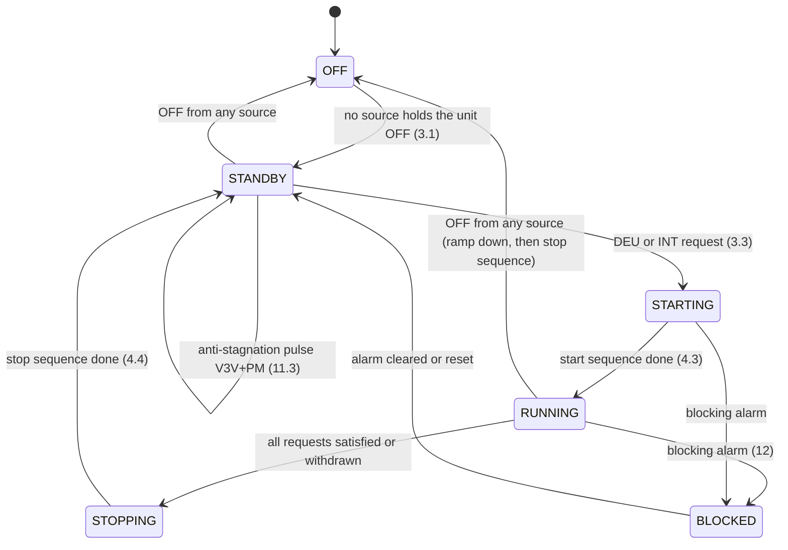

# HRDS+ / Innova DEH+ — how the unit behaves

The **single source of truth on what the unit does**: which operation happens
in which state, for which variant, season and probe configuration, and how
it is commanded from the display, the terminals and Modbus.

Scope rules:

* **Only the unit.** Nothing here describes what the Home Assistant
  integration does on top (guards, entities, defaults it writes). That is in
  [`../../CLAUDE.md`](../../CLAUDE.md) (for agents) and [`../../README.md`](../../README.md)
  (for users).
* **Registers are named, not defined.** Which registers exist, their
  addresses, encodings, ranges and enum values are only in
  [`MODBUS_REGISTERS.md`](MODBUS_REGISTERS.md). This file refers to them by
  name or parameter code (`PU08`, `sm_UnitStatus` 1104) and says what the unit
  *does* with them.
* **Every statement carries its evidence.** If a statement has no tag, treat it
  as a bug in this file.

## 0. Evidence tags and sources

| Tag | Meaning |
|-----|---------|
| `[HB 6.3]` | Technical handbook `HRDS+_Technisches_Handbuch_DE.pdf` (text: `.txt`), section number. The end-user handbook (`HRDS+_Benutzerhandbuch_DE.pdf`) is a word-for-word subset of HB §2.4, §5.2, §7 and §9, so it is cited as HB. |
| `[MB p.7]` | Modbus manual `HRDS+_Modbus_RTU_RS485_DE.pdf`, page. |
| `[IM]` | Innova DEH+ H installation manual EN (OEM original). It describes an **older controller** (microswitches, three fixed fan speeds), not the EVCO "K" board of the HRDS+; cited only for the product line. |
| `[V#76]` | Statement by the vendor side (user Murphy08) in the energiesparhaus.at HRDS+ forum thread, post number. |
| `[F#79]` | Field report by another user in the same thread (not verified here). |
| `[T7]` | **Tested**: seen on the reference unit by the repository owner. Each `T` number is an entry in the [evidence log](#13-evidence-log-what-was-seen-on-real-hardware) with date and source. |
| `[INFERRED]` | **Not backed by a source or a test.** Our reading or extrapolation. Open checks are in [`../../plans/todo.md`](../../plans/todo.md). |

When two sources disagree, both are given and the conflict is marked.

### Quick index for agents

| Question | Section |
|----------|---------|
| Which variants exist, how to tell them apart | [1](#1-variants) |
| What is physically inside; terminals and outputs | [2](#2-hardware-air-path-water-path-terminals) |
| Who can switch the unit on/off, change season, raise a request | [3](#3-control-sources-and-precedence) |
| State diagram, start and stop sequences | [4](#4-state-model) |
| The full decision procedure as pseudo-code | [5](#5-decision-procedure-agent-readable) |
| Summer / winter operating modes, water temperature effects | [6](#6-summer-operation), [7](#7-winter-operation) |
| With / without display, with / without probes | [8](#8-display-and-probe-configurations) |
| Fan, compressor, water valves in detail | [9](#9-fan), [10](#10-compressor), [11](#11-water-circuit) |
| Alarms and what they stop | [12](#12-alarms-and-what-they-do-to-the-flow) |
| What was tested on real hardware | [13](#13-evidence-log-what-was-seen-on-real-hardware) |
| How to do X at the display / terminals / Modbus; settings | [14](#14-actions-and-settings-display-terminals-modbus) |
| As-delivered settings vs handbook defaults | [15](#15-as-delivered-settings-vs-handbook-defaults) |

---

## 1. Variants

### 1.1 Product code

`HRDS+ 30 H R K DC` [HB 2.4]:

| Field | Values | Meaning |
|-------|--------|---------|
| `HRDS+` | — | Inverter (variable-speed) compressor [HB 2.4] |
| `30` / `50` | size | Total airflow up to 300 / 500 m³/h [HB 2.4]. Capacity tables: [`README.md` → Technical data](README.md#technical-data-airflow-capacity-power). |
| `H` | — | Horizontal (ceiling) installation [HB 2.4] |
| `R` | optional | With recirculation: own fan, motorised damper, air filter [HB 2.1 items 8–10 "nur Umluft-Version", HB 2.4] |
| `K` | — | Controller version K [HB 2.4]; an EVCO controller reporting product code `EPB9…` [T1] |
| `DC` | — | Dehumidification and cooling [HB 2.4] |

The handbook lists four part numbers: 30 and 50, each with and without
recirculation, all `K DC` inverter [HB 2.8]. The Innova line also has a `D`
version ("neutral air dehumidification", isothermal) [IM 2.3]; no `D` HRDS+ is
listed [HB 2.8]. On the K controller, `PG02 = 0` switches off cooling and
heating ("integration") [HB 6.1.3], which gives the same function set
[INFERRED].

### 1.2 What differs between the variants

| Aspect | `R` (with recirculation) | non-`R` ("ohne Umluft") |
|--------|--------------------------|-------------------------|
| Air connections | Supply duct from the MVHR **plus** a room-air inlet [HB 3.7.1] | Supply duct only [HB 3.7.2] |
| Own fan, damper, filter | Yes [HB 2.1] | No [HB 2.1, 3.7.2] |
| Airflow through the coil | MVHR supply + recirculated room air, up to the nominal 300/500 m³/h total [HB 3.7.1] | Only what the MVHR pushes [HB 3.7.2] |
| During DEU / INT | Damper opens, fan runs — always, see [§9.3](#93-recirculation-is-coupled-to-every-request-r-variant) [HB 2.7, 6.5; V#44, V#76] | Runs on MVHR flow alone [HB 3.7.2] |
| `VMC` contact use | Typically to **lower** the MVHR speed during requests (more recirculation share) [HB 4.5] | Typically to **raise** the MVHR speed during requests [HB 4.5] |
| Weight (30 / 50) | 46 / 57 kg [HB 10] | 43 / 54 kg [HB 10] |

How to tell them apart from the controller: no register states size or `R`
[MB, whole register list; INFERRED that none exists beyond what is listed].

* **`R` vs non-`R`:** the damper output `outDO_RecircDamper` (1134). On the
  reference `R` unit it reads `0` (off) in standby [T5]. That a non-`R` unit
  reads `2` (disabled, output not allocated) is [INFERRED] from the enum; no
  non-`R` unit has been read.
* **`PG01` is not the `R` flag.** It selects the fan arrangement ("only supply
  fan" / "supply and exhaust fan") [HB 5.3 PG01]. The reference `R` unit reads
  `PG01 = 0` [T5].
* **Integration function:** `PG02` (1 = cooling in summer and heating support
  in winter enabled) [HB 6.1.3]. It is an installer setting, not hardware
  detection [HB 6.1.3].
* **30 vs 50:** not readable [INFERRED]. Type plate only [HB 2.3].
* **Controller:** FC 43 device identification returns vendor `EVCO`, product
  code `EPB9ORSINDEU`, firmware `V01.00.09.02` on the reference unit [T1].
  Whether other sizes/variants report the same product code is open
  [INFERRED; `plans/todo.md`].

### 1.3 Variants seen so far

Only one unit has been read: **HRDS+ 30 `R` `DC`**, no display, no external
probes, Modbus via an RS-485→TCP gateway, behind a Zehnder ComfoAir Q350
[T1, T10]. Everything about the HRDS+ 50, non-`R` units, units with a display
or external probes comes from the documents only.

---

## 2. Hardware: air path, water path, terminals

### 2.1 Air path

1. MVHR supply air (and, on `R`, recirculated room air) is mixed and passes
   the **evaporator** of the refrigerant circuit, which cools it below the dew
   point so moisture condenses [HB 2.6].
2. Directly behind it sits the **water register** ("Nachheizregister"), a water
   coil [HB 2.6, 2.6.3].
3. The compressor modulates to hold the evaporator at **PU11 (6.0 °C)**,
   independent of the airflow [HB 2.6, 6.3].
4. Refrigerant: R410A, hermetically sealed [HB 2.6.3].

### 2.2 Water path

* Water enters the **plate condenser** (refrigerant → water, outside the
  airflow), then an **internal on/off 3-way valve** decides [HB 2.6.1, 2.7]:
  * **open** (series): condenser **and** water register — the condenser heat
    reheats the dried air to about room temperature (DEU), or warm heating
    water heats the air (winter INT), and in standby water can flow through
    both [HB 2.7];
  * **closed**: condenser only — all compressor heat leaves with the water,
    the air stays cold (summer INT) [HB 2.7].
  * It is not proportional: supply air is either well below room temperature
    or near it [HB 2.6.1].
* The **external valve V3V** (2-point, 230 V) and the **pump output PM** are
  switched **together** (relay K5) [HB 4.5].
* The unit has **no heat source** and no electric heater: warming is only
  possible with warm water from the building [HB 2.6.2, 2.7].
* Water flow: 1.5–3.0 l/min (30) / 2.5–4.0 l/min (50) at 16 °C inlet, set
  with the internal valve open; more flow lowers the DEU supply temperature
  [HB 3.8.5].

Hydraulic installations [HB 3.8.6–3.8.8]:

| Variant | Water | Notes |
|---------|-------|-------|
| 1–3: heating/cooling circuit of a heat pump | 16–20 °C in cooling mode [INFERRED typical] | The heat pump must be in cooling mode for summer DEU/INT; the `VMC` contact can request it [HB 3.8.6]. With domestic hot water priority, open the `OFF` input during DHW [HB 3.8.6]. |
| 4–6: brine circuit of a ground-source heat pump | brine | Independent of the heat pump's mode. **No winter heating possible; active winter dehumidification forbidden (coil freezing); anti-stagnation pulses can blow cold air → switch the unit OFF in winter or drive the brine pump separately** [HB 3.8.7]. |
| separate ground loop | brine | Fully independent; same three winter notes [HB 3.8.8]. |

### 2.3 Terminals (inputs and outputs)

| Terminal | Direction | Behaviour | Source |
|----------|-----------|-----------|--------|
| `OFF`–`OFF` | input | Closed = unit may be ON, open = forced OFF. Priority over the display. Factory: bridged. NO/NC set by `HB03`. | [HB 4.4, 4.5, 6.6] |
| `E/I` | input | Open = summer, closed = winter (NO). Display has priority unless `PC11 = 1`. NO/NC set by `HB04`. | [HB 4.4, 4.5, 6.6] |
| `DEU` | input | Closed forces a dehumidify request; stays active even with a display. NO/NC by `HA06`. | [HB 4.5, 6.6] |
| `INT` | input | Closed forces an integration request (cool in summer, heat in winter). NO/NC by `HA07`. | [HB 4.5, 6.6] |
| `FAN+`/`FAN−` | input 0–10 V | Fan speed request, linear across the active mode's band (factory 0 V = 50 %, 10 V = 85 %); the higher of 0–10 V and display wins; > 10 V disables the signal. | [HB 4.5] |
| `V3V` | output 230 V | External 2-point valve; opens on a request; anti-stagnation pulses. | [HB 4.5, 6.4] |
| `PM` | output 230 V | Pump; **always switched together with V3V**. | [HB 4.5] |
| `VMC` | potential-free | Closed on every DEU or INT request, opens when the request ends. For the MVHR speed or the heat pump's cooling mode. | [HB 2.7, 4.5] |
| `ALL` | potential-free | Closed while at least one alarm is active. | [HB 4.5] |
| `RS+`/`RS−` | Modbus RTU | Address, baud, parity, stop bits only settable at the display or service software; power-cycle after a change. | [MB p.5, p.11] |
| `12 0 C+ D−` | CAN | CNU2 display (A+/B− for the older CNU). | [HB 4.5, 4.6] |

Fixed internal inputs: evaporator probe (AI4), water probe (AI5),
high-pressure switch (DI1), low-pressure switch (DI2) with the frost
thermostat on the same input [HB 6.3; as-delivered allocation T2].

---

## 3. Control sources and precedence

The controller accepts commands from three channels at once: CNU2 display,
terminals and Modbus [HB 2.2, 5.1]. How they combine:

### 3.1 On / off

* Sources: display `ESC` key (only if `PH01 = 1`), `OFF/OFF` contact, Modbus
  `Status_OnOff_byBMS` (only if `PH02 = 1`), time programs (`PH03`), clock
  [HB 4.5, 5.2.1; MB p.5]. `sm_UnitStatus` names the source that holds it off
  [MB p.9].
* **An OFF from any source beats every ON** [MB p.5].
* `PC12 = 1`: a `DEU` or `INT` **digital input** starts the unit even with the
  `OFF/OFF` contact open [HB 4.5].
* With `PH01 = 1` and no display the unit stays OFF ("OFF by display")
  [HB 5.1; T2].
* Setting `PH01 = 0` alone does **not** leave "OFF by display": after
  `PH01 = 0`, `HA00 = 0`, `PH02 = 1` and a power cycle the unit still read
  `off_by_display`; the first Modbus ON switched it on at once [T7]. Whether a
  later Modbus OFF reads "OFF by BMS" and survives a power cycle is open
  [`plans/todo.md`].
* OFF: the unit reacts to no request; Modbus and monitoring stay active
  [HB 2.7].

### 3.2 Season (summer / winter)

* Sources: display (user menu), `E/I` contact, or automatic (`PC05`) [HB 4.5,
  5.2.4, 5.3 PC05].
* With a display connected, **the display owns the season** unless `PC11 = 1`
  (then the contact does) [HB 4.5, 5.2.4; MB p.6].
* Without a display, Modbus changes the season by rewriting `HB04`: `4` = DI4
  normally open (open contact = summer), `3` = normally closed (open contact =
  winter). Any other value raises **AL25** (I/O configuration error, everything
  off) [MB p.6]. If a contact is wired to `E/I`, writing `3` inverts its
  meaning [INFERRED from MB p.6]. Writing `HB04` has not been tested
  [`plans/todo.md`].
* Automatic season: `PC05` 0 manual / 1 manual + automatic / 2 automatic,
  `PC06` chooses the water or room probe; with the room probe the unit
  switches to summer above `PC09` and to winter below `PC10` [HB 5.3]. How the
  water-probe variant decides is not described [INFERRED: unknown].
* Read back the season in force with `ModeStatus` (1110: summer/winter ×
  manual/auto/DI) and `Mode_OperatingMode` (1583) [MB p.6, p.9]. As delivered:
  `HB04 = 4`, `ModeStatus` = "Summer DI", `PC05 = 0` [T6].

### 3.3 Requests: DEU and INT

The unit has exactly two requests [HB 2.7, 6.1]:

* **DEU** — dehumidify.
* **INT** — "integration": dehumidify + cool in summer, heating support in
  winter [HB 2.6, 2.7, 4.5].

Each request is the **OR** of its sources; any one raises it [HB 6.1]:

| Request | Automatic (display or external room probe) | Digital input | Modbus | Coupling |
|---------|--------------------------------------------|---------------|--------|----------|
| DEU | Room RH > `PU01 + PU07` → on, < `PU01` → off; held off while room T < `PU13`, back on above `PU13 + PU14` [HB 6.1.1] | `DEU` contact [HB 6.1.1] | `Status_Dehum_byBMS` with `PH28 = 1` [HB 6.1.1] | Summer INT request + `PU05 = 1` also raises DEU [HB 6.1.1] |
| INT | Summer: room T > `SEtC + PF12` → on, < `SEtC − PF12` → off. Winter: room T < `SEtH − PF12` → on, > `SEtH + PF12` → off [HB 6.1.2] | `INT` contact [HB 6.1.2] | `Status_Integ_byBMS` with `PH27 = 1` [HB 6.1.2] | — |

* `PG02 = 0` disables INT in both seasons [HB 6.1.3].
* The automatic requests cannot be cleared over Modbus; only switching the
  unit off stops them [INFERRED from HB 6.1: no Modbus point disables the
  automatic logic].
* Readability: the **effective** DEU request is `DehumRequest` (1121) [MB
  p.9]; the effective INT request is not readable — only the Modbus request
  (1139) and the digital input bits (`Packed_logicDI1`) [MB p.6, p.8;
  INFERRED that nothing else exposes it].
* A Modbus request is mirrored back late: on the reference unit an OFF written
  to `Status_OnOff_byBMS` read back as ON for several polls, and the register
  and `sm_UnitStatus` changed together at one later poll [T8]. The length of
  the lag is open [`plans/todo.md`].
* Winter automatic heating: `SEtH` is clamped to `PH09..PH10`, factory
  14.0 °C both [HB 5.3]. The handbook says this "prevents" automatic heating
  [HB 5.2.3, 6.1.2]. With `PF12 = 0.5 K` the unit still heats whenever the
  room is below 13.5 °C [INFERRED from HB 6.1.2]. To keep it from heating,
  lower `PH09` first, then `SEtH` [INFERRED].
* Writes to the "by BMS" registers are ignored while the matching enable
  (`PH02`/`PH27`/`PH28`) is 0 [MB p.5].
* A request written while its enable is 0 is probably kept by the unit and
  starts once the enable is turned on [INFERRED; untested, `plans/todo.md`].

### 3.4 Setpoints

* `SEtC`, `SEtH` and `PU01` are only effective when a display is present or
  external probes are connected [MB p.6].
* `SEtC` is clamped to `PH07..PH08`, `SEtH` to `PH09..PH10`, `PU01` to
  `PH29..PH30` [HB 5.3]. As delivered: `PH07 = PH08 = 28.0 °C`,
  `PH09 = PH10 = 14.0 °C`, `PH29 = 55 %`, `PH30 = 65 %`, `Actual_Setpoint` read
  28.0 °C [T2].
* Default `SEtH`: 14.0 °C [HB 5.3] vs 20.0 °C [MB p.6] — **sources disagree**.

### 3.5 Fan speed

See [§9](#9-fan). In short: display request, 0–10 V and the Modbus manual
setpoint feed the fan; the **highest** wins; each is scaled into the active
mode's min–max band [HB 4.5, 6.2]. Whether the Modbus setpoint `PM20` follows
the same scaling is [INFERRED], not tested.

### 3.6 Persistence across a power cycle

* Parameters are kept. The Innova display-panel manual lists "internal memory
  with data storage even in the event of abnormal shutdown or power failure"
  [IM p.28]; that text describes the older panel, not the K board, so for the
  K board it is only supporting evidence.
* On the reference unit `PH01 = 0` and `PH02 = 1` survived a power cycle: the
  first Modbus ON took effect immediately afterwards, which an OFF-by-display
  priority (`PH01` back at 1) or an ignored write (`PH02` back at 0) would
  have prevented [T7; the reading of T7 is INFERRED]. `HA00` and the other
  parameters were not observed directly [INFERRED].
* Whether the request registers (`Status_OnOff_byBMS`, `Status_Integ_byBMS`,
  `Status_Dehum_byBMS`) survive a power cycle is untested
  [`plans/todo.md`].
* The clock does not survive a long power cut (AL26) [HB 5.2.4].
* Parameters are held in non-volatile memory [IM p.28 wording "internal
  memory"]; a write-cycle limit is not documented anywhere [INFERRED that
  there is one].

---

## 4. State model

### 4.1 States



Sources: HB 2.7 (OFF, ON-standby, DEU, INT), HB 6.2–6.5 (sequences), HB 7.3
(alarms). `RUNNING` has the variants in §4.2.

### 4.2 Outputs per state

`R` variant. A non-`R` unit has no damper and fan; the rest is the same
[HB 2.7, 3.7.2; INFERRED for the controller outputs of a non-`R` unit].

| State | Damper / fan | Compressor | Internal valve | V3V + PM | `VMC` | Supply air | Source |
|-------|--------------|------------|----------------|----------|-------|------------|--------|
| OFF | closed / off | off | open | closed | open | untreated | [HB 2.7] |
| ON-standby | closed / off | off | open | closed, except anti-stagnation pulses | open | untreated; warmed or cooled if water flows through condenser and register without an external valve | [HB 2.7] |
| DEU (summer) | open / on, band `PF28..PF10` | on | open (heat to register) | open | closed | dry, about room temperature | [HB 2.6.1, 2.7, 6.2] |
| INT summer, `PU05 = 1` | open / on, band `PF27..PF09` | on | **closed** (heat to water) | open | closed | dry and cold | [HB 2.6.1, 2.7, 6.2, 6.4] |
| Summer DEU/INT, water < `PU08` | open / on | **off** (second step after `PU10` if `PU09 = 1`) | open | open | closed | cooled and dried by the cold water | [HB 6.3]; internal valve [INFERRED from HB 6.4: only activated with the compressor on] |
| INT winter | open / on | **off** | open | open | closed | warmed only if the water is warm | [HB 2.6.2, 2.7, 4.5, 6.4] |
| BLOCKED (blocking alarm) | closed immediately | off | — | closed immediately | — | untreated | [HB 6.4, 6.5, 7.3] |

### 4.3 Start sequence

1. Request raised (any source) [HB 6.1].
2. External water valve V3V + pump PM open, damper opens, `VMC` closes
   [HB 6.4, 6.5, 4.5; V#76 gives this order].
3. Fan starts after the damper pre-start time `PS01` (handbook 20 s; reference
   unit 90 s) [HB 6.2, 6.5; T2].
4. Compressor starts `PE04` after the fan (dehumidify; handbook 120 s,
   reference unit 180 s) and only when the safety times allow: min off time
   `PE01`, min time between starts `PE03` [HB 6.3; T2]. It first runs at the
   start speed `PE28` for `PE30`, then modulates [HB 6.3].
5. Commissioning note: at least **7 minutes** from activation to the first
   compressor start [HB 8.2]. That matches `PE03 = 420 s` [INFERRED].

The compressor does not start (step 4) while: a blocking alarm is active, a
time program blocks it, room T < `PU13`, or (summer) water < `PU08` [HB 6.3].

### 4.4 Stop sequence

1. Request ends (all sources clear) [HB 6.3].
2. Compressor stops once its minimum on time `PE02` has passed; on an OFF or a
   blocking alarm it ramps down via `PE25` [HB 6.3].
3. V3V + PM stay open for the run-on `Pb01` (handbook 255 s; reference unit
   30 s), so water keeps flowing while the compressor ramps down [HB 6.4; T2].
4. Fan runs on for `PF03` at speed `PF26`, keeps its minimum run time `PF01`,
   and **in any case until V3V has closed** [HB 6.2].
5. Damper closes after the request has ended, the compressor is off and V3V
   has closed [HB 6.5].
6. After the valve closes, the anti-stagnation cycle starts counting [HB 6.4].
7. With `PU09` second step active, the request counts as finished only after
   `PU10` has passed since the compressor stopped; water keeps flowing
   meanwhile [HB 6.3].

---

## 5. Decision procedure (agent-readable)

Pseudo-code of what the controller evaluates. Every line cites its source.
Names are parameter codes or register names from
[`MODBUS_REGISTERS.md`](MODBUS_REGISTERS.md).

```text
# ---------- on / off ----------
held_off_by =
    display    if PH01 == 1 and (display says OFF or no display present)   # HB 5.1, MB p.5; T2
    DI         if OFF/OFF contact open (per HB03) and not (PC12 == 1 and DEU/INT DI active)  # HB 4.5
    BMS        if PH02 == 1 and Status_OnOff_byBMS == 0                    # MB p.5
    scheduler  if PH03 == 1 and a time program says OFF                    # HB 5.2.4
    RTC        clock fault / clock rule                                    # MB p.9 (meaning of "OFF by RTC" INFERRED)
unit_on = no source holds it off                                           # MB p.5: OFF beats ON
# stored OFF: after PH01 1->0 and a power cycle the unit stayed "OFF by display" until a Modbus ON  # T7

# ---------- season ----------
if display present and PC11 == 0: season = display setting                 # HB 4.5, 5.2.4
elif PC05 == 2: season = auto (PC06: water or room probe; room: >PC09 summer, <PC10 winter)  # HB 5.3
else: season = E/I contact read through HB04 (4: open = summer, 3: open = winter)  # HB 4.5, MB p.6
# HB04 not in {3, 4} -> AL25                                               # MB p.6

# ---------- requests ----------
room_T, room_RH = from display (HA00) or AI2/AI3 probes (HA02/HA03), else none  # HB 6.7
deu_auto = room_RH available and hysteresis(room_RH, on > PU01+PU07, off < PU01)
           and not held_off(room_T < PU13, release > PU13+PU14)            # HB 6.1.1
           and (season == summer or PU02 != 0)                             # HB 5.3 PU02 (INFERRED that PU02 gates winter DEU this way)
int_auto = room_T available and (
             summer: hysteresis(room_T, on > SEtC+PF12, off < SEtC-PF12)
             winter: hysteresis(room_T, on < SEtH-PF12, off > SEtH+PF12))  # HB 6.1.2
INT = PG02 == 1 and (int_auto or INT_DI or (PH27 == 1 and Status_Integ_byBMS))   # HB 6.1.2, 6.1.3
DEU = deu_auto or DEU_DI or (PH28 == 1 and Status_Dehum_byBMS)
      or (season == summer and INT and PU05 == 1)                          # HB 6.1.1
# DehumRequest (1121) reads DEU; INT itself is not readable                # MB p.9

# ---------- outputs while unit_on and DEU or INT ----------
VMC = closed                                                               # HB 4.5
V3V = PM = open  if season == summer (DEU or INT) or season == winter INT  # HB 6.4
           (winter DEU with PU02 == 1 "with water": INFERRED open; PU02 == 2 "without water": INFERRED closed)
damper = open (R only)                                                     # HB 6.5
fan = on after PS01, band PF28..PF10 (DEU) or PF27..PF09 (INT)             # HB 6.2

compressor_wanted = (summer and INT and PU05 == 1) or DEU_DI or deu_auto
                    or (PH28 == 1 and Status_Dehum_byBMS)                  # HB 6.3
compressor_blocked = blocking alarm or time program or room_T < PU13       # HB 6.3 (no room_T: unknown, INFERRED)
                     or (summer and water_T < PU08 and not PU09_step_due)  # HB 6.3
                     or (summer and AL03 and not (DEU only and PU03 == 1)) # HB 7.4
                     or safety times PE01/PE03 or fan not yet on for PE04  # HB 6.3
compressor = compressor_wanted and not compressor_blocked
# winter: HB 6.3 lists no winter case; compressor in winter only for DEU with PU02 != 0 (INFERRED)

internal_valve = closed if compressor and INT and season == summer else open   # HB 6.4
# K4 read 1 in standby on the reference unit; MB labels K4 1 = "Dehumidify" (open)  # T5, MB p.8

# ---------- protections, any time ----------
water_T < PA43 for PA42           -> AL16: fan off; clears > PA43 + PA44   # HB 7.4
summer, valve on, water_T > PC07 for PA16 -> AL03                          # HB 7.4
winter INT, valve on, water_T < PC08 for PA16 -> AL04                      # HB 7.4
```

---

## 6. Summer operation

| Request | Condition | What happens | Supply air | Source |
|---------|-----------|--------------|------------|--------|
| none | — | ON-standby (§4.2) | untreated | [HB 2.7] |
| DEU | water ≥ `PU08` | Compressor; internal valve open | dry, ≈ room T | [HB 2.6.1, 2.7] |
| DEU or INT | water < `PU08` (handbook 10 °C) | **Passive cold-water path**: compressor stays off; cold water in the register cools and dries the air. If the request is still open after `PU10` (120 min) and `PU09 = 1`, the compressor joins as a second step; that step ends when the request is satisfied, water keeps flowing | cooled and dried, no compressor | [HB 6.3] |
| INT, `PU05 = 1` (factory) | water ≥ `PU08` | DEU is raised too; compressor on; internal valve **closed** | dry and cold | [HB 2.7, 6.1.1, 6.3, 6.4] |
| INT, `PU05 = 0`, no DEU | water ≥ `PU08` | INT does not start the compressor; valve/pump and fan run; cooling by the water only | cooled by water only | [INFERRED from HB 6.1.1, 6.3, 6.4]; untested [`plans/todo.md`] |
| INT + DEU | water ≥ `PU08` | Compressor on and a cooling request → internal valve **closed** | dry and cold | [HB 6.4]; untested |
| any | water > `PC07` (handbook 30 °C) for `PA16` (600 s) while the valve is open | **AL03**: INT blocked, DEU blocked unless `PU03 = 1`; valve "sniffing" `Pb02`/`Pb03`; clears below `PC07 − PA17` | — | [HB 7.4]; MB p.7 says the compressor stops above PC07 and restarts 2 K below |

Notes:

* There is no cooling without dehumidification while the compressor runs:
  the evaporator always condenses [HB 2.6].
* The water source decides the mode: brine early in summer is often below
  `PU08` → passive path; a heat pump in cooling mode delivers about 16–20 °C →
  compressor [INFERRED from HB 3.8.6, 6.3]; a heating-only circuit is too warm
  to take the heat → AL03 [INFERRED from HB 7.4].
* Neither the passive path nor `PU05 = 0` has been seen on the reference unit
  [`plans/todo.md`].

## 7. Winter operation

| Request | Condition | What happens | Source |
|---------|-----------|--------------|--------|
| none | — | ON-standby; anti-stagnation pulses can blow cold air on brine | [HB 2.7, 3.8.7] |
| INT (`PG02 = 1`) | water ≥ `PC08` | **Heating support**: compressor off, both valves open, V3V+PM open, fan runs; warms only with warm water | [HB 2.6.2, 2.7, 4.5, 6.4] |
| INT | water < `PC08` for `PA16` | **AL04**: heating blocked, valve sniffing; clears above `PC08 + PA17`. MB: heating starts only above PC08 + 2 K | [HB 7.4; MB p.7] |
| INT automatic | room T < `SEtH − PF12` | The unit heats by itself whenever a room temperature is available (§3.3) | [HB 6.1.2] |
| DEU | `PU02 = 0` (factory) | No winter dehumidification | [HB 5.3 PU02; INFERRED that this also blocks DI/Modbus DEU] |
| DEU | `PU02 = 1` "with water" / `2` "without water" | Winter dehumidification enabled. What "with/without water" changes (V3V/PM open or not) is not described | [HB 5.3; INFERRED: unknown] |
| any, brine circuit | — | Heating impossible; active winter DEU forbidden (coil freezing); switch the unit OFF in winter | [HB 3.8.7, 3.8.8] |

* `PC08`: handbook and Modbus manual 20.0 °C, reference unit 10.0 °C [HB 5.3;
  MB p.7; T2].
* Heating has not been seen on the reference unit [`plans/todo.md`].

## 8. Display and probe configurations

| Configuration | Required settings | Room T/H | Automatic DEU/INT | Setpoints act | Season owner | Source |
|---------------|-------------------|----------|-------------------|---------------|--------------|--------|
| CNU2 display (T+H) | `PH01 = 1`, `HA00 = 6` | display's own sensors | yes | yes | display (`PC11 = 0`) or `E/I` (`PC11 = 1`) | [HB 5.1, 6.7, 8.1] |
| CNU2 display T only + external humidity | `HA00 = 5`, `HA03 = 53/54` | display T, AI3 humidity | yes | yes | as above | [HB 6.7] |
| No display, external probes | `PH01 = 0`, `HA00 = 0`, `HA02 = 45`, `HA03 = 53/54` | AI2 NTC 10 kΩ B3435, AI3 0–10 V or 4–20 mA | yes | yes | `E/I` or `HB04` over Modbus | [HB 6.7; MB p.6]; untested |
| **Headless** (no display, no probes) | `PH01 = 0`, `HA00 = 0`, `HA02 = HA03 = 0` | none | **no** — only `DEU`/`INT` inputs and Modbus requests | **no** | `E/I` or `HB04` | [HB 5.1, 8.1; MB p.6]; reference unit [T2, T3, T7] |
| Display configured, none fitted | `PH01 = 1` | — | — | — | — | Unit stays "OFF by display" [HB 5.1; T2] |

Observations and consequences:

* Unwired analog inputs read a sentinel word (`0x8004`), not 0; the factory
  water and evaporator probes read real values [T3]. Details:
  [`MODBUS_REGISTERS.md` §14.7](MODBUS_REGISTERS.md#147-unwired-analog-inputs-read-a-sentinel-not-a-temperature).
* Probe alarms AL28 (room T) / AL34 (room RH) are meant to fire when a
  configured source is missing [HB 7.3]. On the headless reference unit,
  "OFF by display", none were set [T4]; whether they appear once ON is open.
* `PU13` with no room temperature: whether the interlock vetoes a Modbus or DI
  dehumidify request is **open** [INFERRED: unknown; `plans/todo.md`]. As
  delivered `PU13 = 10.0 °C` (handbook 22.0) [T2].
* The outdoor probe (`AI_Toutdoor`) only drives free cooling/heating, and
  only when `PG03 = 1` [HB 5.3 PG03]. Free cooling acts through a "Bypass
  Free-Cooling/Free-Heating" relay output, one of the allocatable outputs
  [HB 5.3]; [INFERRED] that a standard HRDS+ has no such bypass wired. As
  delivered `PG03 = 1` with no outdoor probe [T2].
* Exhaust and discharge probes are display-only [INFERRED from HB 6, which
  uses neither].
* Old CNU display (`HA00 = 1/2`): the reference unit shipped with `HA00 = 2`
  without any display [T2].

## 9. Fan

### 9.1 Bands and sources

* Active band: DEU `PF28..PF10`, INT `PF27..PF09`; factory 50–85 % [HB 6.2;
  MB p.7].
* Sources: display manual request (fan screen, step `PF11`), 0–10 V
  potentiometer, Modbus `PM20_SupplyFan_Manual`. The highest request wins; the
  display and potentiometer requests are scaled linearly into the band
  [HB 4.5, 6.2]. So request 0 → band minimum, not a stopped fan [INFERRED from
  HB 6.2].
* Display manual control works while no time programs are enabled (`PH03`)
  and a DEU request, or an INT request with `PF31 ≠ 0`, is active [HB 6.2]. `PF31 = 0`: INT fan follows the
  room temperature (`PF12`, `PF13`) [HB 5.3 PF31].
* Whether `PM20` is scaled into the band (rescale), clipped to it (clamp) or
  absolute is **open**; to command an absolute value, set the band to 0–100
  [INFERRED; `plans/todo.md`]. One user could not get the fan below 30 %
  [F#77].
* `PF07..PF08` ("VMC" band) bounds the post-run speed `PF26` [HB 5.3 PF26]. The
  HRDS+ has no ventilation-only mode with its fan [HB 2.7]; [INFERRED] that
  `PF07/PF08` matter only for run-on.
* Read-backs: `outAO_SupplyFan` (actual output), `actRPMsupplyFan`,
  `SupplyFan_ManualRequest` (display's request), `SupplyFan_RemoteRequest`
  (potentiometer) [MB p.7, p.8, p.15].

### 9.2 Timing

* Starts `PS01` after the damper opens [HB 6.2].
* Minimum run time `PF01`, run-on `PF03` at `PF26`, and always until V3V is
  closed [HB 6.2].
* AL16 (water antifreeze) stops the fan [HB 7.3].
* States Disabled / OFF / Wait ON / ON / Wait OFF (run-on) / Alarm
  (overheating or speed sensing) [HB 6.2].

### 9.3 Recirculation is coupled to every request (`R` variant)

* Every DEU and INT request opens the damper and runs the fan; only OFF /
  ON-standby has the damper closed [HB 2.7, 6.5].
* "Ohne Umluft" is the hardware variant, not an operating mode [HB 2.1, 2.8,
  3.7.2].
* Vendor: "whenever the compressor runs, recirculation is active" [V#44];
  dehumidification is strictly coupled to recirculation; start order water
  valve, damper and VMC, then fan after a delay, then compressor [V#76];
  setting the fan to 0 does not help, the damper opens anyway [V#78].
* No register selects "dehumidify without recirculation" [MB].
* Field reports (unofficial, not tried here) [F#77–#79, #93]:
  * Disabling the fan output (AO4) or the damper output (DO1) stops the
    compressor from starting.
  * Fan output moved to the spare AO3 (`HC03 = 1`, `HC04 = 0`) plus damper
    relay inverted (`HD01` 10 → 9, NO → NC): an HRDS+ 50 ran on MVHR supply air
    alone at 368 m³/h with about 1.7 l/h of condensate. The inverted damper is
    then **open in standby** [INFERRED from the NO/NC meaning].
  * After moving the fan output, the controller reports a fan that is not
    turning (`outAO_SupplyFan`, `SupplyFan_Status`) [INFERRED].
* With the damper open and the fan slow or stopped, the recirculation inlet is
  connected to the supply chamber; if the inlet is teed into the MVHR extract
  duct, supply air short-circuits into the extract [INFERRED from HB 3.7.1
  airflow layout]. A backdraft valve in that branch prevents it [INFERRED].
* AL11 (low pressure / frost thermostat) remains the compressor's guard
  against too little airflow [HB 6.3, 7.4].

### 9.4 Non-`R` variant

No own fan; airflow comes from the MVHR only [HB 3.7.2]. The `VMC` contact
can raise the MVHR speed during requests [HB 4.5]. That this proves the
refrigerant circuit works on MVHR flow alone follows from the design
[HB 3.7.2]; what a non-`R` controller reports for fan and damper is
[INFERRED], no unit read.

## 10. Compressor

* Turns on for: summer INT with `PU05 = 1`, `DEU` input, room RH >
  `PU01 + PU07`, Modbus DEU with `PH28 = 1` [HB 6.3].
* Turns off when all hold: INT satisfied (with `PU05 = 1`), `DEU` input
  inactive, room RH < `PU01`, Modbus DEU cleared [HB 6.3].
* Does not start with: a blocking alarm, a blocking time program, room T <
  `PU13`, summer water < `PU08` [HB 6.3].
* Modulation: incremental neutral-zone control on the evaporator temperature:
  above `PU11 + PU12` step up by `PE08` every `PE09`, below `PU11 − PU12` step
  down [HB 6.3]. Output limits: DEU `PE06..PE07`, INT `PE21..PE22` [HB 6.3].
* Inverter: start speed `PE28` for `PE30`; hold at `PE29` for `PE31`; below
  `PE28` for longer than `PE32` → off; ramps `PE24`/`PE25`/`PE26` (enabled by
  `PE33`) [HB 6.3].
* Safety times `PE01` min off, `PE02` min on, `PE03` min between starts,
  `PE04` fan-to-compressor delay [HB 6.3].
* No active defrost; a frost thermostat on the low-pressure input stops the
  compressor via AL11 [HB 6.3].
* Status values Disabled / Alarm / Manual / OFF / Wait ON / Wait OFF / ON
  [HB 6.3]. Read back `CmpStatus` and `outAO_Cmp` [MB p.8, p.9].

## 11. Water circuit

### 11.1 Internal valve (relay K4)

* Compressor off → deactivated; compressor for dehumidification only →
  deactivated; compressor on **and** a cooling request → activated [HB 6.4].
* In hydraulic terms: "open" (water through condenser and register) in
  OFF/standby, DEU and winter INT; "closed" (condenser only) in summer INT
  [HB 2.7].
* **Read-back conflict.** The reference unit read `outDO_WaterCond` (1124) =
  1 (ON) and `Packed_DO1` bits 12–13 = 1 in standby [T5], where HB 6.4 says
  "deactivated". The Modbus manual annotates those `Packed_DO1` bits
  "0 = Integration, 1 = Dehumidify" [MB p.8]. Reading: `1` means the
  dehumidify/open position, which is also the standby position [INFERRED].
  Not yet read while cooling [`plans/todo.md`].

### 11.2 External valve V3V and pump PM (relay K5)

* Open (one output) on a summer DEU/INT request and a winter INT request
  [HB 6.4, 4.5]. Not opened in standby except the anti-stagnation pulses
  [HB 2.7].
* Run-on `Pb01` after the request ends [HB 6.4].
* Closed immediately on a blocking alarm [HB 6.4].
* Not configured (output disabled) means the unit cannot drive a pump
  [MB p.15 "Disable"; INFERRED consequence]. As delivered `HD05 = 12` (water
  valve) [T2].

### 11.3 Anti-stagnation and sniffing

* General anti-stagnation: always enabled; after the valve closes, wait `Pb08`
  (hours) then open for `Pb07` (seconds); also one cycle of `Pb07` when the
  unit is switched on [HB 6.4].
* Whether it also runs while the unit is OFF: HB 2.7 lists it under ON; HB 4.5
  says the outputs pulse "independent of operation"; HB 3.8.7 recommends OFF
  to avoid the cold bursts on brine — **sources unclear**; the OFF advice
  suggests OFF stops it [INFERRED].
* Sniffing on AL03 (summer) / AL04 (winter): wait `Pb03`, open `Pb02`, repeat
  until the alarm clears during an open phase [HB 6.4].

### 11.4 Water temperature thresholds (summary)

| Threshold | Effect | Source |
|-----------|--------|--------|
| `PA43` (3.0 °C) for `PA42`, clear at `PA43 + PA44` | AL16, fan off | [HB 7.4] |
| `PU08` (10.0 °C), summer | Below: no compressor (passive path) | [HB 6.3] |
| `PC08` (HB 20.0, ref. unit 10.0 °C), winter | Below for `PA16`: AL04, heating blocked | [HB 7.4; T2] |
| `PC07` (30.0 °C), summer | Above for `PA16`: AL03, INT (and DEU unless `PU03`) blocked | [HB 7.4] |

The water probe reads the water in the unit: with V3V closed it shows the
standing water, not the circuit [INFERRED; the reference unit read 18.7 °C in
standby, T3].

## 12. Alarms and what they do to the flow

Codes, bit positions and reset registers:
[`MODBUS_REGISTERS.md` §9](MODBUS_REGISTERS.md#9-alarms). Behaviour [HB 7.3,
7.4]:

| Alarm | Trigger | Effect on the flow | Reset |
|-------|---------|--------------------|-------|
| AL02 | Room RH > `PA19`, or `DEU` input longer than `PA58`, for longer than `PA21` | `PA57 = 0` (factory): display only. `PA57 = 1`: unit stops | Power cycle; display-only also when the DEU demand is satisfied; blocking after `PA60` |
| AL03 | Summer, valve active with a request, water > `PC07` for `PA16` | INT blocked, DEU blocked unless `PU03 = 1`, sniffing | Water < `PC07 − PA17` |
| AL04 | Winter INT, valve active, water < `PC08` for `PA16` | Heating blocked, sniffing | Water > `PC08 + PA17` |
| AL11 | Low-pressure switch or frost thermostat for `PA31` (bypassed `PA30` after a start); also if active when a start is requested | Compressor stops / does not start | Auto; manual after `PA32` events per hour |
| AL12 | High-pressure switch | Compressor stops at once | Auto; manual after `PA35` per hour |
| AL16 | Water < `PA43` for `PA42` | Fan stops | Water > `PA43 + PA44` |
| AL18 | Generic alarm | Everything off | Manual |
| AL22 | Fan hours reach the limit | Display only | Manual (alarm menu, or fan hours to 0) |
| AL25 | I/O configuration error (e.g. `HB04` not 3/4) | Everything off | Auto [MB p.6] |
| AL26 | Clock lost (long power cut) | Time programs disabled | Auto |
| AL28 / AL29 / AL30 / AL34 / AL36 / AL39 | Room T / outdoor / water / room RH / fan potentiometer / evaporator probe fault | "Disables the controls that depend on it" | Auto |

* A blocking alarm closes the damper and the external valve at once [HB 6.4,
  6.5].
* Alarms are visible while the unit is OFF [HB 7.3].
* No alarm bits were set on the reference unit as delivered [T4].

---

## 13. Evidence log: what was seen on real hardware

Reference unit: **HRDS+ 30 `R` `DC`**, headless (no display, no external
probes), RS-485→TCP gateway, behind a Zehnder ComfoAir Q350. "Dump" means
[`tests/devices/hrds_30+_headless_factory_state.json`](../../tests/devices/hrds_30+_headless_factory_state.json)
(read-only diagnostic, taken before the integration wrote anything).

| # | Date | What | Source |
|---|------|------|--------|
| T1 | 2026-10 | FC 43/14 identity (basic, regular, extended): `EVCO` / `EPB9ORSINDEU` / `V01.00.09.02`; all four status registers hold documented enum values | dump |
| T2 | 2026-10 | As-delivered settings: see [§15](#15-as-delivered-settings-vs-handbook-defaults). Unit status `off_by_display` (with `PH01 = 1`, no display) | dump |
| T3 | 2026-10 | Unwired analog inputs 499, 500, 502–506, 508–510, 512 read `0x8004`; 507 reads `0x7FFA`; water (501) 18.7 °C and evaporator (511) 16.8 °C read real values; inputs 513–519 read 0 (unidentified) | dump |
| T4 | 2026-10 | No alarm bits set (768/769/770 = 0, `OR_Alarms` = 0) while OFF by display with no probes | dump |
| T5 | 2026-10 | `R` unit: `PG01 = 0`; damper output 1134 = 0 (off); fan status OFF; compressor status OFF; 1112 = 0; K5 (1126) = 0; **K4 (1124) = 1** and `Packed_DO1` bits 12–13 = 1 in standby | dump |
| T6 | 2026-10 | Season: `HB04 = 4`, `ModeStatus` = Summer DI, `Mode_OperatingMode` = summer, `PC05 = 0` | dump |
| T7 | 2026-10-20 | `PH01 = 0`, `HA00 = 0`, `PH02 = 1` and a power cycle: still `off_by_display`. First Modbus ON → `on` at once (so `PH01` and `PH02` kept their values, §3.6) | [`plans/todo.md`](../../plans/todo.md), PR #31 |
| T8 | 2026-10-21 | OFF written to `Status_OnOff_byBMS`: register read ON for several polls; register and `sm_UnitStatus` changed together at one later poll | PR #32 |
| T9 | 2026-10-20 | Through the RS-485→TCP gateway a 120-register read got no reply at all; 10-register reads covered the whole map | PR #28 |
| T10 | 2026-10 | Installation context: HRDS+ 30 behind a Zehnder ComfoAir Q350 | PR #14 |

Not yet observed on hardware (everything else in this file): a running DEU or
INT cycle with recorded fan/damper/compressor/valve read-backs, the passive
cold-water path, winter operation, `HB04` season writes, `PM20` vs fan output,
any display or probe configuration, the HRDS+ 50 and non-`R` units. The test
plans are in [`plans/todo.md`](../../plans/todo.md). When a test is done, add a
`T` row here and replace the `[INFERRED]` tag where it applies.

Third-party field reports (energiesparhaus.at HRDS+ thread):

| # | Who | What |
|---|-----|------|
| V#44 | vendor side, 2025-12-04 | "Immer wenn der Kompressor läuft, ist auch der Umluftbetrieb aktiv." |
| V#76 | vendor side, 2026-05-08 | Dehumidification strictly coupled to recirculation; start order water valve, damper and VMC output, fan after a delay, then compressor |
| V#78 | vendor side, 2026-05-08 | Fan 0 "bringt ja nichts, weil die Klappe dann trotzdem aufgeht"; unsure whether `HD01 = 0` works without a restart |
| F#77–#79 | user manuon, 2026-05 | Fan not below 30 %; AO4 or DO1 disabled → no compressor start; `HD01` NO → NC inverts the damper |
| F#93 | user manuon, 2026-05 | AO3 fan reassignment + `HD01` NC on an HRDS+ 50: MVHR supply only, 368 m³/h, about 1.7 l/h condensate |

---

## 14. Actions and settings: display, terminals, Modbus

How each operation is done through each channel. Register addresses and the
write recipes are in
[`MODBUS_REGISTERS.md` §11](MODBUS_REGISTERS.md#11-cookbook--common-operations).

| Action | CNU2 display | Terminals | Modbus | Unit behaviour / notes |
|--------|--------------|-----------|--------|------------------------|
| Switch on / off | Hold `ESC` 2 s (needs `PH01 = 1`) [HB 5.2.1] | `OFF/OFF` contact [HB 4.5] | `Status_OnOff_byBMS`, needs `PH02 = 1` [MB p.5] | OFF from any source wins (§3.1) |
| Change season | User menu [HB 5.2.4]; only there while a display is connected and `PC11 = 0` | `E/I` contact [HB 4.5] | Rewrite `HB04` 4/3 [MB p.6] | §3.2; AL25 on other values |
| Dehumidify | Automatic from RH vs target [HB 5.2.3] | `DEU` contact [HB 4.5] | `Status_Dehum_byBMS`, needs `PH28 = 1` | §3.3, §6, §7 |
| Cool (summer) / heat (winter) | Automatic from T vs target [HB 5.2.3] | `INT` contact [HB 4.5] | `Status_Integ_byBMS`, needs `PH27 = 1` and `PG02 = 1` | §3.3, §6, §7 |
| Target humidity | Humidity screen, OK, ↑/↓ [HB 5.2.3] | — | `PU01` | Clamped `PH29..PH30`; only effective with display or probe [MB p.6] |
| Target temperature | Temperature screen [HB 5.2.3] | — | `SEtC` / `SEtH` | Clamped `PH07..PH08` / `PH09..PH10` (§3.4) |
| Fan speed | Fan screen, hold ↑/↓ 2 s while the fan runs [HB 5.2.3] | `FAN` 0–10 V [HB 4.5] | `PM20_SupplyFan_Manual`; band `PF27/PF28`–`PF09/PF10` | Highest request wins; scaling of `PM20` open (§9.1) |
| Reset an alarm | Alarm menu, hold OK 3 s [HB 5.2.4] | — | Reset registers (AL11/AL12/AL18) [MB p.10] | Only when the cause is gone [HB 5.2.4] |
| Reset filter alarm AL22 | Alarm menu or counters menu (fan hours → 0) [HB 7.4] | — | Write 0 to `PM01` [MB p.9] | Fan hours count in h×10 [HB 5.2.4; MB p.9] |
| Time programs | Time program menu; disabled as delivered [HB 5.2.4] | — | `PH03` | Can hold the unit OFF and block the compressor (§3.1, §10) |
| Clock | `CLOCK` line [HB 5.2.4] | — | — | Lost after a long power cut → AL26 [HB 5.2.4] |
| Modbus address / baud / parity / stop bits | Installer menu → MODBUS (installer password) [MB p.11] | — | Listed R/W, but only configurable at the display or service software [MB p.5] | Power-cycle after a change [MB p.11] |
| Other parameters | Service, maintenance, installer, manufacturer menus (password levels; manufacturer only while OFF) [HB 5.2.4] | — | Most are holding registers ([`MODBUS_REGISTERS.md` §16](MODBUS_REGISTERS.md#16-installer-menu-parameters-installer-device)) | Changes can void the warranty [HB 5.2.4] |

### 14.1 Settings that decide the flow

What each setting does is in the sections above; this table is the lookup.

| Setting | Decides | Section |
|---------|---------|---------|
| `PH01`, `PH02`, `PH27`, `PH28`, `PC12`, `HB03`, `PH03` | Who may switch on/off and raise requests | §3.1, §3.3 |
| `HA00`, `HA02`, `HA03` | Room T/H source → automatic requests | §8 |
| `PC05`, `PC06`, `PC09`, `PC10`, `PC11`, `HB04` | Season | §3.2 |
| `PG02` | Integration (cool/heat) at all | §3.3 |
| `PG03` | Free cooling/heating on the outdoor probe | §8 |
| `PU01`, `PU07`, `PU13`, `PU14`, `SEtC`, `SEtH`, `PF12`, `PH07`–`PH10`, `PH29`, `PH30` | Automatic request thresholds and clamps | §3.3, §3.4 |
| `PU02`, `PU03`, `PU05`, `PU08`, `PU09`, `PU10` | Winter DEU, DEU under AL03, INT→DEU coupling, passive path | §6, §7 |
| `PC07`, `PC08`, `PA16`, `PA17`, `PA42`–`PA44` | Water temperature limits and alarms | §11.4, §12 |
| `PF27`, `PF28`, `PF09`, `PF10`, `PF31`, `PF01`, `PF03`, `PF26`, `PS01` | Fan bands and timing | §9 |
| `PU11`, `PU12`, `PE01`–`PE33` | Compressor | §10 |
| `Pb01`, `Pb02`, `Pb03`, `Pb07`, `Pb08` | Valve run-on, sniffing, anti-stagnation | §11 |
| `HC03`, `HC04`, `HD01`, `HD05` | Which output drives fan, damper, water valve | §9.3, §11.2 |

## 15. As-delivered settings vs handbook defaults

The reference unit did not ship with the handbook's factory values [T2]. The
distributor presumably pre-configures units [INFERRED]. Do not assume the
handbook default on a real unit; read it.

| Setting | Handbook default | Reference unit as delivered | Effect |
|---------|------------------|-----------------------------|--------|
| `HA00` | 6 (CNU2 T+H) [HB 5.3; MB p.5] | 2 (old CNU T+H) | Expects a display that is not there |
| `PH01` / `PH02` | 1 / 0 [HB 5.3] | 1 / 0 | OFF by display |
| `PH27` / `PH28` | 1 / 1 [MB p.5] | 1 / 1 | — |
| `PG03` | 0 [HB 5.3] | 1 | Free cooling enabled without an outdoor probe |
| `PU07` | 5 % [HB 5.3] | 3 % | Narrower DEU hysteresis |
| `PU13` | 22.0 °C [HB 5.3, 7.2] | 10.0 °C | DEU allowed down to 10 °C room T |
| `PC08` | 20.0 °C [HB 5.3; MB p.7] | 10.0 °C | Winter heating with cooler water |
| `PS01` | 20 s [HB 5.3] | 90 s | Fan starts 90 s after the damper |
| `PE04` | 120 s [HB 5.3] | 180 s | Longer fan → compressor delay |
| `Pb01` | 255 s [HB 5.3] | 30 s | Shorter valve run-on |
| `Pb08` | 99 h [HB 5.3] | 60 h | More frequent anti-stagnation |
| `PF01` / `PF03` | 10 / 0 s [HB 5.3] | 60 / 30 s | Longer fan minimum run and a run-on |
| `PH07` / `PH08` | 14.0 / 28.0 °C [HB 5.3] | 28.0 / 28.0 °C | `SEtC` pinned to 28.0 °C (`Actual_Setpoint` read 28.0) |
| `PH09` / `PH10` | 14.0 / 14.0 °C [HB 5.3] | 14.0 / 14.0 °C | `SEtH` pinned to 14.0 °C |
| `PH29` / `PH30` | — | 55 / 65 % | `PU01` limited to 55–65 % |
| `PU05`, `PU08`, `PU09`, `PU10`, `PC07`, `PA43` | 1, 10.0, 1, 120, 30.0, 3.0 [HB 5.3] | same | — |
| `PF27`/`PF28`, `PF09`/`PF10` | 50 / 85 % [HB 5.3] | same | — |
| `PC11`, `PC12`, `PH03`, `PA57`, `PU02`, `PU03` | 0 [HB 5.3] | same | — |
